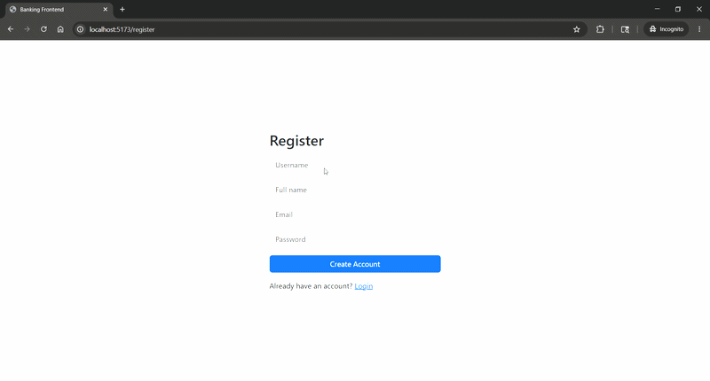
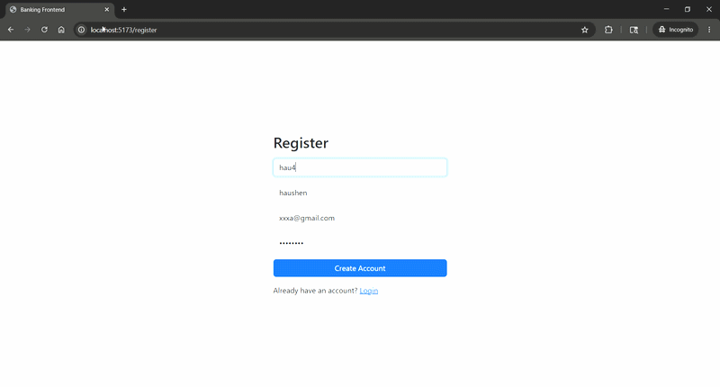
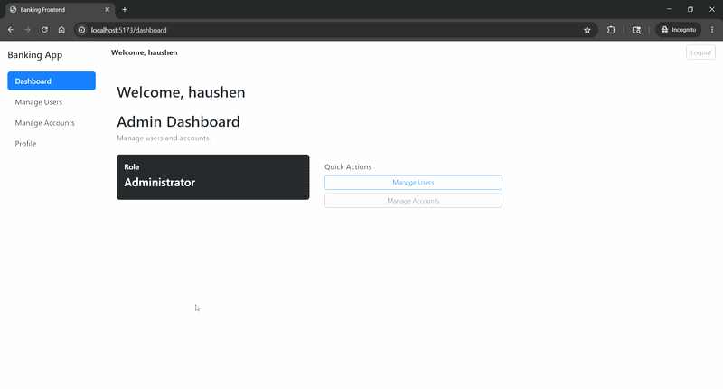
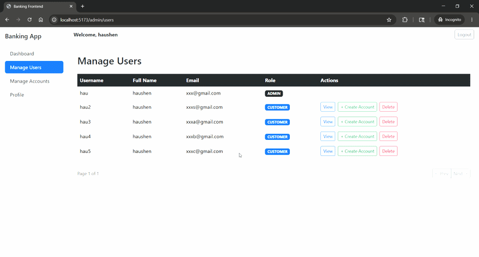
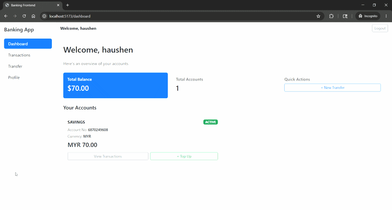

# 🏦 Banking App

[](https://github.com/HauShen/Banking-app/actions/workflows/ci.yml)

A full-stack banking simulator built with **Java Spring Boot** and **React**, featuring JWT
authentication, role-based access control, fund transfers (also paid in a foreign currency), foreign remittances,
and an admin management panel.


---

## 🎬 Demo

### 🔐 First Admin (Bootstrap)
> The first admin is created automatically at startup from configuration when no admin exists.
> There is no public sign-up for admins — see [Getting Started](#3-configure-environment).

---

### 👤 Register as Customer
> New users can self-register as a customer.



---

### ⚠️ Username & Email Validation
> System rejects duplicate usernames and emails with clear error messages.



---

### 🏧 Admin — Create Account for Customer
> Admin can create bank accounts and assign them to customers.



---

### 🛠️ Admin — Manage Customers & Accounts
> Admin panel for managing all users and accounts, including status updates.



---

### 💸 Customer — Top Up, Transfer & Transactions
> Customers can top up balance, transfer funds, and view transaction history.



---

## 🚀 Tech Stack

### Backend
| Technology | Purpose |
|---|---|
| Java 21 + Spring Boot 3.4.5 | REST API framework |
| Spring Security + JWT | Authentication & authorization |
| Spring Data JPA + Hibernate | ORM & database access |
| PostgreSQL | Relational database |
| Flyway | Database schema migrations |
| Lombok | Boilerplate reduction |
| springdoc-openapi (Swagger UI) | Interactive API documentation |
| JUnit 5 + Spring Boot Test + Testcontainers | HTTP-level integration tests against a real PostgreSQL |

### Frontend
| Technology | Purpose |
|---|---|
| React 18 + Vite | UI framework & build tool |
| TanStack React Query | Server state management |
| React Hook Form | Form handling |
| React Router v6 | Client-side routing |
| Axios | HTTP client |
| Bootstrap 5 | Styling |

### DevOps
| Technology | Purpose |
|---|---|
| Docker | Multi-stage image of the backend: JDK 21 to build, JRE 21 to run, non-root user |
| Docker Compose | PostgreSQL; with `--profile app` also the backend |
| GitHub Actions | CI: full build and every test on each push and pull request; CD: publishes the image after each merge to `master` |
| GitHub Container Registry | Home of the published image: `ghcr.io/haushen/banking-app` (`latest` and one `sha-…` tag per commit) |

---

## ✨ Features

### 👤 Customer
- Register & login with JWT authentication
- View dashboard with account summary
- Top up own accounts (cash deposit)
- Transfer funds **from own accounts only**, with **idempotency protection** (no double transfers)
- Pay a transfer in **USD, SGD, EUR or JPY**: the MYR equivalent at the bank's sell rate moves
  (see [Foreign currency](#-foreign-currency))
- See the bank's exchange rates and a quote before paying, or **lock a rate for 60 seconds** and pay at exactly
  that rate
- View transaction history of own accounts, including the original currency, amount and rate
- Update profile

### 🛡️ Admin
- Open bank accounts (Savings / Current) for customers
- Manage all users — view, update profile, change role, delete
- Manage all accounts — view, lock / unlock, delete (blocked when the account has transaction history)
- Record **incoming foreign remittances** (simulates the bank's payment gateway): credited in MYR at the buy rate
- Safety rails: an admin cannot change their own role or delete themselves, and the last admin cannot be removed
- Privileged actions (role changes, deletions, edits to other users, bootstrap) are written to an audit log

---

## ⚙️ Getting Started

### Prerequisites
- Java 21+
- Node.js 18+
- Docker Desktop

### 1. Clone the repository
```bash
git clone https://github.com/HauShen/Banking-app.git
cd Banking-app
```

### 2. Start PostgreSQL with Docker
```bash
docker compose up -d
```

### 3. Configure environment
Secrets are never committed. Create a `.env` file in the project root (it is git-ignored and loaded at startup):
```properties
POSTGRES_PASSWORD=abc123
JWT_SECRET=<output of: openssl rand -base64 48>
```
`abc123` is the default password in `docker-compose.yaml`. The JWT secret must be Base64 on a single line.

The `dev` profile creates a demo admin on first start, when no admin exists yet:
**`devadmin` / `DevAdmin123!`** (dev only — intentionally public). Outside dev, set
`BOOTSTRAP_ADMIN_ENABLED=true` plus `BOOTSTRAP_ADMIN_USERNAME`, `BOOTSTRAP_ADMIN_FULLNAME`,
`BOOTSTRAP_ADMIN_EMAIL` and `BOOTSTRAP_ADMIN_PASSWORD` for the first deployment.

### 4. Run the backend
```bash
./gradlew bootRun --args='--spring.profiles.active=dev'
```
Backend runs on `http://localhost:8080`. Swagger UI (dev profile only): `http://localhost:8080/swagger-ui/index.html`
(log in with `POST /api/auth/login`, then paste the `accessToken` into **Authorize**).
If the frontend runs somewhere other than `http://localhost:5173`, set `CORS_ALLOWED_ORIGINS` (comma-separated).

**Or run the backend in Docker too** (no local JDK needed):
```bash
docker compose --profile app up --build
```
This builds the image from the `Dockerfile` and starts it next to PostgreSQL with the `dev` profile, on the same
`http://localhost:8080`. It reads `POSTGRES_PASSWORD` and `JWT_SECRET` from the same `.env`. Stop a running
`bootRun` first, because both use port 8080. A plain `docker compose up -d` still starts PostgreSQL only.

### 5. Run the frontend
```bash
cd src/frontend
cp .env.example .env
npm install
npm run dev
```
Frontend runs on `http://localhost:5173`

---

## 🔐 API Endpoints

All endpoints except `/api/auth/**` and `GET /actuator/health` require:
```
Authorization: Bearer <your-jwt-token>
```
Try them interactively in Swagger UI (dev profile): `http://localhost:8080/swagger-ui/index.html`.

**Access:** *Public* = no token · *Logged in* = any valid token · *Owner* = the logged-in user owns the account ·
*ADMIN* = admin role. Rules marked *Owner* are enforced in the use cases, not just by role.

#### Authentication
| Method | Endpoint | Access | Description |
|---|---|---|---|
| POST | `/api/auth/register` | Public | Register as a customer: access token in the body, refresh token in a cookie |
| POST | `/api/auth/login` | Public | Log in: access token in the body, refresh token in a cookie |
| POST | `/api/auth/refresh` | Refresh cookie | New access token + new refresh cookie (the old one is used up) |
| POST | `/api/auth/logout` | Logged in | Log out on every device: all access and refresh tokens stop working, cookie cleared (204) |
| GET | `/api/auth/bootstrap-status` | Public | Whether bootstrap is enabled and an admin exists |

#### Health
| Method | Endpoint | Access | Description |
|---|---|---|---|
| GET | `/actuator/health` | Public | `{"status":"UP"}` when the app and its database connection work, otherwise 503 with `DOWN`. No details, and nothing else under `/actuator` is exposed |

#### Users
| Method | Endpoint | Access | Description |
|---|---|---|---|
| GET | `/api/users/me` | Logged in | Own profile |
| PUT | `/api/users/me` | Logged in | Update own name / email |
| POST | `/api/users/create` | Logged in | Create a customer profile (no token returned) |
| GET | `/api/admin/users` | ADMIN | List users (paged, sortable) |
| GET | `/api/admin/users/{id}` | ADMIN | User by id |
| GET | `/api/admin/users/by-username/{username}` | ADMIN | User by username |
| POST | `/api/admin/users` | ADMIN | Create another admin |
| PUT | `/api/admin/users/{id}` | ADMIN | Update a user's profile (audited) |
| PATCH | `/api/admin/users/{id}/role` | ADMIN | Change role (audited; not own role, not the last admin) |
| POST | `/api/admin/users/{id}/revoke-tokens` | ADMIN | Log a user out of every device, e.g. a compromised account (204) |
| DELETE | `/api/admin/users/{id}` | ADMIN | Delete a user (audited; not self, not the last admin) |

#### Accounts
`{id}` is the account's database id (`accountId`), not the account number.

| Method | Endpoint | Access | Description |
|---|---|---|---|
| GET | `/api/accounts/summary` | Logged in | Own accounts and total balance |
| POST | `/api/accounts/create` | ADMIN | Open an account for a customer (RM20 opening balance) |
| PATCH | `/api/accounts/{id}/topup?amount=` | Owner | Cash deposit |
| GET | `/api/accounts/{id}` | Owner or ADMIN | Account by id |
| GET | `/api/accounts/number/{accountNumber}` | Owner or ADMIN | Account by account number |
| GET | `/api/accounts/get_all/{user_id}` | Owner or ADMIN | All accounts of a user |
| GET | `/api/accounts/get_all?status=` | ADMIN | All accounts, optional `ACTIVE` / `LOCKED` filter |
| PATCH | `/api/accounts/{id}/status?status=` | ADMIN | Lock or unlock an account |
| DELETE | `/api/accounts/{id}` | ADMIN | Delete an account (409 if it has transaction history) |

#### Transfers
| Method | Endpoint | Access | Description |
|---|---|---|---|
| POST | `/api/transfers` | Owner of the from-account | Transfer funds (201); `idempotencyKey` makes retries safe (409 if reused for a different transfer); optional `currency` of the amount (default MYR) and `quoteId` (pay at a locked rate) |
| GET | `/api/transfers/{reference}` | Sender, recipient or ADMIN | One transaction |
| GET | `/api/transfers/account/{accountNumber}` | Owner or ADMIN | Transaction history of an account (paged) |
| POST | `/api/admin/remittances` | ADMIN | Money from abroad arrives for an account (201): converted at the buy rate, idempotent like transfers |

#### Foreign exchange
| Method | Endpoint | Access | Description |
|---|---|---|---|
| GET | `/api/fx/rates` | Logged in | The bank's buy and sell rate for every offered currency (MYR per 1 unit) |
| GET | `/api/fx/quote?currency=USD&amount=100.00&direction=PAY` | Logged in | What an amount is worth in MYR now; `direction` `PAY` (sell rate, default) or `RECEIVE` (buy rate) |
| POST | `/api/fx/quotes` | Logged in | Lock the sell rate for `currency` + `amount` (201): `quoteId`, rate, MYR amount, `expiresAt` (60 s) |

---

## 💱 Foreign currency

Modelled on everyday Malaysian savings accounts: **accounts stay in MYR**, and foreign money is converted when it
comes in or goes out. The transaction remembers the original currency, amount and rate.

- **Pay in a foreign currency:** `POST /api/transfers` with `"amount": 100.00, "currency": "USD"` moves the MYR
  equivalent between two MYR accounts. Without `currency` (or with `MYR`) a transfer works exactly as before.
- **Receive money from abroad:** `POST /api/admin/remittances` credits a MYR account. Admin only: customers can't
  create incoming money; in a real bank this would be the payment gateway.
- **Which rate:** as banks quote it, from the bank's side. The customer pays in USD → the bank sells USD → **sell
  rate**. Money arrives in USD → the bank buys it → **buy rate** (lower). `GET /api/fx/quote` shows the same numbers
  before confirming.
- **Locking a rate:** a quote alone is only a preview: the transfer uses the rate at the moment it runs. To pay at
  a fixed rate, `POST /api/fx/quotes` with the currency and amount returns a `quoteId` valid for 60 seconds
  (`fx.quote-validity`); the transfer then sends the same `currency` and `amount` plus `quoteId`:
  ```json
  { "fromAccountNumber": "…", "toAccountNumber": "…", "amount": 100.00, "currency": "USD",
    "quoteId": "3f9a0c12-b7d4-4e5f-8a6b-1c2d3e4f5a6b", "description": "Rent", "idempotencyKey": "…" }
  ```
  A quote belongs to the user who locked it and works once. It is used up inside the transfer's database
  transaction (its row locked with `SELECT … FOR UPDATE`), so a transfer that fails — e.g. on the minimum balance —
  leaves it usable, and two transfers racing for one quote get it only once. Refused with 400: "Quote not found"
  (also for someone else's quote, so ids reveal nothing), "The quote has already been used", "The quote has
  expired", "The quote is for a different currency or amount", and a quote with a MYR transfer.
- **Rules:** MYR amount = foreign amount × rate, rounded half-up to 2 decimals, at least RM 0.01. The foreign amount
  can't have more decimals than its currency (JPY none, others 2). Rates are stored with 8 decimals (JPY ≈ 0.03).
- **Retries:** a retry with the same `idempotencyKey` is matched on the **original** currency and amount, so it
  returns the original transaction even if the rate has changed since — or its quote has been used — and nothing
  is converted or moved twice.
- **History:** every transaction now has a `type` (`TRANSFER`, `CASH_DEPOSIT`, `FOREIGN_REMITTANCE`) and, for foreign
  ones, `originalCurrency`, `originalAmount` and `exchangeRate`. Remittances show "Foreign Remittance" as the sender.
- **Rates** come from configuration (`fx.rates.USD.buy`, `fx.rates.USD.sell`, ...); the currencies listed there are
  the ones offered. A wrong rate (zero, buy above sell, too many decimals) stops the application at startup.
- **Design:** exchange rates live in their own `fx` module. It owns the conversion rule; the transaction module asks
  it through its own port (`CurrencyConversionPort`), so a transfer books exactly what the quote shows. Locked
  quotes are fx's own table (`fx_quotes`). A live rate feed would replace one adapter
  (`ConfiguredExchangeRateSource`) without touching any business code.

---

## 🔒 Security

### Authentication: stateless JWT
1. `POST /api/auth/login` checks the password against its **BCrypt** hash and returns a JWT signed with
   HS256 (`sub` = username, **15-minute** expiry by default). The signing key comes from `JWT_SECRET`, never from Git.
2. Every request sends `Authorization: Bearer <token>`. `JwtRequestFilter` verifies the signature and expiry,
   then **reloads the user from the database**, so a role change or deletion takes effect on the next request,
   not when the token expires.
3. No server-side session (`SessionCreationPolicy.STATELESS`). API calls authenticate with the `Authorization`
   header, which a browser never adds by itself, so CSRF protection is disabled. The one cookie (below) is
   protected by `SameSite=Strict` instead.
4. **Revocation without a blacklist:** every user has a token version (table `user_token_versions`) and every
   token carries the version it was issued with (claim `ver`). `POST /api/auth/logout` — or an admin via
   `/revoke-tokens` — increases the version, so all older tokens of that user are rejected immediately.
5. **Refresh tokens:** login also sets a `refresh_token` cookie — `HttpOnly` (JavaScript can't read it),
   `Secure`, `SameSite=Strict` (never sent from another site), `Path=/api/auth`, valid 7 days. When the access token
   expires, `POST /api/auth/refresh` exchanges the cookie for a new access token and a **new** refresh token.
   - Only a SHA-256 hash of each refresh token is stored (table `refresh_tokens`), so a database leak leaks no usable tokens.
   - Each refresh token works **once** (rotation). Presenting a used one again means someone has a copy: the whole
     token family is revoked and the user's token version increases, so the thief's access token dies too.

A missing, garbage, tampered, expired, revoked or deleted-user token is ignored by the filter (the request continues
as anonymous) — it never crashes the request, and a stale token never blocks `/api/auth/login`.

### Authorization: three layers
| Layer | Where | Example |
|---|---|---|
| URL rules | `SecurityConfig` | `/api/auth/**` public, `/api/admin/**` admin only, everything else needs a token |
| Role checks | `@PreAuthorize("hasRole('ADMIN')")` | Opening, locking and deleting accounts |
| Ownership checks | Use cases / services | Only the owner can transfer from or top up an account; history is owner-or-admin |

Ownership rules live in the application layer: the web adapter turns the logged-in user into an
`AccountRequester(userId, admin)`, so the use cases enforce "owner or admin" without depending on Spring Security.
**Admins cannot move a customer's money** — transfers and top-ups are owner-only for everyone.

### Status codes
| Code | Meaning |
|---|---|
| 401 | Not logged in: no token, or a token that is invalid, expired, revoked (after logout), or belongs to a deleted user |
| 403 | Logged in, but not allowed (wrong role, or not your account) |
| 401 + `Invalid credentials` | Failed login — the same message for a wrong password and an unknown user, so usernames can't be probed |
| 429 + `Retry-After` | Too many failed logins for this username or from this IP — try again after the given number of seconds |

### Other protections
- **Login brute-force protection:** 5 failed logins for one username within 15 minutes lock that username for
  15 minutes (unknown usernames too, so a lockout reveals nothing); 20 failures from one IP block that IP.
  While locked, even the correct password gets 429. Limits are configurable (`security.login.*`).
- Registration has no `role` field: nobody can sign themselves up as admin.
- Every error, including 401/403 from the security layer, uses the same JSON body
  (`timestamp`, `status`, `error`, `message`, `path`); unexpected errors are logged, never shown to the client.
- CORS only allows the configured frontend origin (`CORS_ALLOWED_ORIGINS`, default `http://localhost:5173`)
  and only the `Authorization` and `Content-Type` headers.
- Swagger UI and the API docs are only enabled in the `dev` profile.
- Transaction responses never contain another user's internal id.
- An idempotency key belongs to the account that first used it: reusing another account's key returns 400
  instead of that account's transaction — also when both requests arrive at the same moment.
- Retrying with the same key returns the original transfer (same reference and time) and debits only once, even
  when the retries arrive at the same moment. Reusing a key for a different amount or recipient returns 409.
  For a transfer paid in a foreign currency, "the same amount" means the same original currency and amount.
- Remittances follow the same rules: the same request again returns the original and credits once; a key used for
  anything else returns 409.
- Amounts can have at most 2 decimals (400 otherwise), matching the database columns.
- Transfers, top-ups and remittances lock the account rows (`SELECT … FOR UPDATE`, always in the same order), so
  concurrent requests can't overwrite each other's balance or deadlock. A locked quote's row is locked last, after
  the accounts.

### Known limitations
- Login throttling is in memory: it resets on restart and isn't shared between several instances
  (production: Redis, or rate limiting at the API gateway).
- A username lockout can be abused to lock someone out for 15 minutes by failing on purpose — the usual trade-off
  of account lockout; real systems add CAPTCHA or progressive delays.
- Behind a reverse proxy, enable `server.forward-headers-strategy=native`, otherwise every client shares the
  proxy's IP for the per-IP limit.
- Logout is "log out everywhere": there is no per-device logout.
- The frontend still keeps the access token in `localStorage`, which any XSS could read. With refresh cookies in
  place it should keep the access token in memory only and call `/api/auth/refresh` on page load (frontend rewrite).
- Two browser tabs refreshing at the same moment with the same cookie look like token reuse and log the user out —
  the frontend should run one refresh at a time.
- Used and expired refresh tokens stay in the table; a scheduled cleanup job is not implemented yet.
- Exchange rates are fixed in configuration (example values, not live rates). A live feed (e.g. a central bank's
  API, with caching and a fallback) would be a new adapter behind `ExchangeRateSourcePort`.
- Locked quotes are only for paying transfers; remittances always use the current buy rate. Used and expired
  quotes stay in `fx_quotes`; a scheduled cleanup job is not implemented yet (like refresh tokens).
- The bank's margin between buy and sell rate is not booked anywhere: a transfer debits and credits the same MYR
  amount, and there is no FX revenue account.
- Remittances are simulated: an admin call stands in for the payment gateway, and the sender is just a name.
- Only currencies with at most 2 decimal places can be offered (e.g. not KWD, which has 3).
- **By design:** on account-number lookups, 404 (unknown) vs 403 (not yours) shows whether an account number
  exists. Hiding it would not help: a transfer has to confirm that the recipient's account exists anyway, as
  real banks do. The defence against probing account numbers is rate limiting, not hiding the status code.

---

## 🧪 Running Tests

Requires **Docker** running: the tests start a real PostgreSQL 17 container with Testcontainers.
```bash
./gradlew test
```

GitHub Actions runs the full build (`./gradlew build`, which includes every test below) on each push to
`master` and on each pull request: see `.github/workflows/ci.yml`. The HTML test report is attached to every run.
A second job builds the Docker image, starts it with PostgreSQL through Docker Compose, and waits for
`/actuator/health` to answer UP.
After a merge to `master`, and only if both jobs passed, a third job publishes the image to GitHub Container Registry.

The security tests are black-box HTTP tests: a real embedded server on a random port, real JWTs, a real database
with every Flyway migration applied. Because they only talk HTTP, they stay valid while the code behind the
endpoints is refactored.

| Test Class | What It Covers |
|---|---|
| `AuthenticationSecurityTest` | Missing, garbage, tampered, forged, expired and deleted-user tokens → 401; a stale token doesn't block login; failed logins look identical; the bootstrap admin exists |
| `AuthorizationSecurityTest` | Customer on admin URLs and admin-only methods → 403; `role` in registration is ignored; viewing or topping up someone else's account → 403 |
| `LoginThrottlingSecurityTest` | 5 failures lock a username → 429 with `Retry-After`, even with the right password; unknown usernames lock the same way; other users unaffected; a success resets the count; the lock expires |
| `LoginIpThrottlingSecurityTest` | Failures spread over many usernames from one IP block that IP, then the block expires (own Spring context with a low limit) |
| `RefreshTokenSecurityTest` | Login/register set a hardened cookie (HttpOnly, Secure, SameSite=Strict, Path); refresh gives a working access token and rotates the cookie; reusing a used token revokes the family and the current access token; missing/garbage cookie → 401; logout and admin revoke-tokens kill refresh tokens; deleted user → 401 |
| `TokenRevocationSecurityTest` | Logout → the same token gets 401, on every device, while other users and a fresh login still work; admin revoke-tokens; customers can't revoke others (403); unknown user (404) |
| `CorsSecurityTest` | Preflight from the configured frontend → allowed; from another site, or asking for an unlisted header → 403 |
| `HealthEndpointSecurityTest` | `/actuator/health` is public and says only UP, without details; health sub-paths and the rest of Actuator → 401 |
| `TransferSecurityTest` | Only the owner can transfer (admins too get 403) and balances are checked; idempotent retries debit once; reusing another account's key → 400; history visible only to owner / recipient / admin |

Feature tests in the same style cover the rest, for example:

| Test Class | What It Covers |
|---|---|
| `ForeignCurrencyTransferTest` | Paying in USD / JPY moves the right MYR amount at the sell rate; history shows the original amount and rate; MYR unchanged; bad currency or decimals → 400; a retry after a rate change returns the original; mismatches → 409 |
| `RemittanceEndpointTest` | Admin-only remittances credited at the buy rate; "Foreign Remittance" in the history; locked / unknown account; idempotency; delete after a remittance → 409 |
| `FxEndpointTest` | Rates list and quotes (PAY / RECEIVE), unsupported currency, bad parameters → 400 (never 500), login required; locking a quote (201, stored for the user, valid 60 s) |
| `LockedQuoteTransferTest` | Paying at a locked rate even when today's differs; the quote works once; a failed transfer leaves it usable; expired, someone else's, unknown, other amount / currency, or with MYR → 400; a retry returns the original |
| `ArchitectureTest` | 22 ArchUnit rules: each module's domain is plain Java, adapters → application → domain, and modules reach each other only through inbound ports (account ↔ transaction, transaction → fx) |
